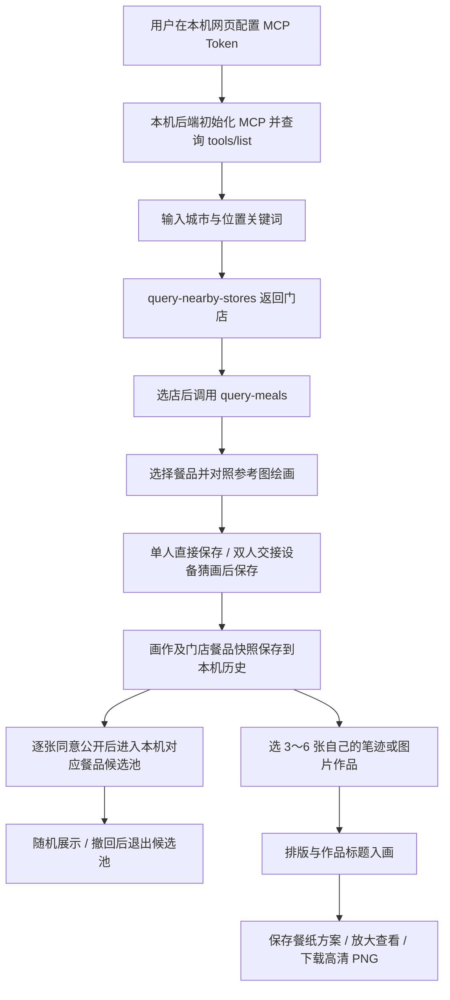

# 你画我点 · 麦当劳 MCP 接入说明

## 项目与业务价值

你画我点是一款围绕当天餐品的绘画互动应用，面向喜欢涂鸦、记录用餐，以及与朋友一起猜画的用户。用户还可把积累的作品拼成个人餐纸。参赛演示以可在电脑浏览器运行的 Web 应用为主，仓库同时保留微信小程序源码。

麦当劳 MCP 为应用提供真实门店、该门店的到店自取菜单、餐品名称、分类和参考图。用户先选店、选餐，再在画布绘画；单人可以直接保存，双人可以交接设备猜画。画作保留门店和餐品编码，获得逐张公开许可后，进入对应门店、对应餐品的随机展示候选池。

因此，MCP 查询结果决定可绘制的餐品和画作归属，不只是用于装饰的固定菜单。画作的本地保存、猜画判定和公开许可由本项目实现，未通过 MCP 上传作品或修改麦当劳官方菜单。当前画廊仅在当前设备模拟公开展示。

个人餐纸使用自己的 3～6 张作品，将真实餐品触发的创作延伸成可保存、可编辑的排版方案和高清 PNG。经用户确认，已接入留白、规则满铺和错落拼贴三种模板，新建默认留白；旧方案继续使用固定的原版布局，不自动改版。作品可以是原始笔迹或导入图片；图片导入、样例导入、备份、草稿恢复和餐纸渲染均由本项目在本机完成，没有调用额外的 MCP 工具。

浏览器画廊支持餐品名称或别称搜索、分类与「只看有作品」组合筛选，为每道餐品显示最多 3 张随机预览与公开作品总数。点击后进入对应门店和餐品的作品墙，按最新创作时间或随机顺序浏览，分批加载并支持画作放大。「只看有作品」、预览、总数、作品墙和放大视图都从同一个已授权候选池读取，随机顺序不会重复画作，撤回许可后不再展示。

## 实际使用的 Server 与协议

| 项目 | 当前实现 |
| --- | --- |
| MCP Server | `https://mcp.mcd.cn` |
| 传输协议 | Streamable HTTP |
| 客户端 | `@modelcontextprotocol/sdk` 的 `Client`、`StreamableHTTPClientTransport` |
| 身份凭证 | 后端读取 `MCD_MCP_TOKEN`，使用 Bearer 鉴权 |
| 业务工具 | `query-nearby-stores`、`query-meals` |

运行中的应用通过官方 SDK 连接该 Server，完成初始化并查询 `tools/list`，检查上述工具是否可用。调用时按工具返回的输入 schema 将数字枚举适配为需要的字符串类型；协议中的 JSON 和 SSE 响应均交给 SDK 处理。

实现见 [server/mcd.js](server/mcd.js)，本机 HTTP 接口见 [scripts/serve.js](scripts/serve.js)。

## Tool 与调用参数

### `query-nearby-stores`：搜索真实门店

输入来自用户填写的城市和位置关键词。应用使用以下业务参数：

| 参数 | 取值或来源 |
| --- | --- |
| `searchType` | `2` |
| `beType` | `1` |
| `city` | 用户输入的城市 |
| `keyword` | 用户输入的附近地标或位置关键词 |

应用保留返回的 `storeCode`、可用的 `beCode`、门店名称、地址和营业状态，供用户选店及后续菜单查询。门店 ID 为 `mcd:<storeCode>:1`。

### `query-meals`：查询所选门店菜单

| 参数 | 取值或来源 |
| --- | --- |
| `storeCode` | 上一步返回、用户所选门店的编码 |
| `beCode` | 门店返回该编码时传入 |
| `orderType` | `1`，当前使用到店自取菜单 |
| `beType` | `1` |

应用读取返回的餐品编码、名称、分类和 HTTPS 参考图。餐品 ID 为 `mcd:<storeCode>:<mealCode>`，即使不同门店出售同名餐品，画作也不会混用。参考图缺失时提示用户对照实物绘画。

价格可能附带会员或随单优惠条件，当前实现不展示价格、不计算订单金额。实际餐品、价格和供应状态以麦当劳官方渠道为准。

## 完整调用与使用流程

网页通过同源的 `GET /api/mcd/status`、`GET /api/mcd/stores`、`GET /api/mcd/menu` 请求本机后端，由后端持有凭证并调用 MCP。浏览器不会直接向 MCP Server 发送 Token。

保存时记录门店、餐品的名称和编码快照；以后菜单改名或餐品下架，历史记录仍能显示创建时的名称。旧版演示画作保留原演示 ID，不会被误关联到真实门店。所有画作默认私密，主动授权时记录许可时间，撤回后立即移出候选池。

“体验三幅示例”是用户主动确认后的画册/餐纸导入，使用独立示例门店和餐品 ID，不作为 MCP 搜索结果、菜单缓存或失败回退。未配置 Token 时仍可体验示例作品和个人餐纸；真实选店、选餐和与真实门店关联的绘画，仍需实际查询成功。示例包与整册备份不含麦当劳 Token，备份含私人作品与用餐历史，分享前需自行检查。

## 配置、凭证与调用边界

- 从 [麦当劳开放平台](https://open.mcd.cn/mcp)申请自己的 Token。在本机网页的「连接麦当劳」面板填写，或在本机 `.env.local` 中设置 `MCD_MCP_TOKEN`。
- 页面保存的凭证仅写入后端 `.env.local`，权限为 `600`；该文件已被 Git 忽略。状态和查询接口不会返回 Token，错误也不会透传含凭证的上游原始信息。
- [mcp-config.example.json](mcp-config.example.json)提供脱敏的 MCP 客户端配置，鉴权值只含环境变量占位符。它用于说明 Server 配置，不是本项目的启动配置文件。外部客户端需支持环境变量展开，或通过其安全配置界面设置凭证。本项目启动时直接使用后端环境配置。
- 默认服务仅监听 `127.0.0.1`。保存配置的接口校验同源 Origin 和随机 nonce；静态文件访问不开放后端源码、环境文件、依赖目录或私有设备配置。
- 后端使用工具白名单，只调用上述两项查询工具。没有通用 MCP 工具转发，不调用领券、创建订单或支付工具。
- 本公开版不附带局域网联调脚本或设备凭据；小程序源码仅保留作参考，真机联调暂停。麦当劳 Token 不进入小程序包。

## 失败处理

未配置 Token、鉴权失败、工具未开放、查询失败或返回格式不支持时，界面显示状态和重试入口。菜单尚未成功刷新时不能开始当前餐品绘画，运行中的应用不会用测试夹具或旧演示菜单冒充真实查询结果。已保存的历史记录独立保留在本机。

## 验证证据与当前限制

原开发版本于2026年10月11日完成真实门店与菜单查询及绘画主线验证；本候选包不附带查询截图、用户历史或实际菜单缓存。2026年10月15日本轮只验证无Token冷启动及离线自动测试，没有新增实时上游连接结论。候选实际结果见[审查记录](docs/PUBLIC_RELEASE_REVIEW.md)。

未实现账户、云端作品存储、跨设备画廊、远程双人、实体印刷和门店定制；小程序未编译或真机验收。本项目由Codex辅助开发，不申报WorkBuddy专项奖励、不包含workbuddy.md。

## 官方参考

- [麦当劳 MCP Server](https://github.com/M-China/mcd-mcp-server)
- [麦当劳 MCP 工具文档](https://open.mcd.cn/mcp/doc)
- [活动完整规则](https://github.com/M-China/mcd-developer-innovation-challenge/blob/main/activityGuidelines.md)（2026年10月15日只读核对）

报名步骤及待办见[提交清单](docs/SUBMISSION_CHECKLIST.md)。公开文件、实际发布、报名成功是不同状态。
