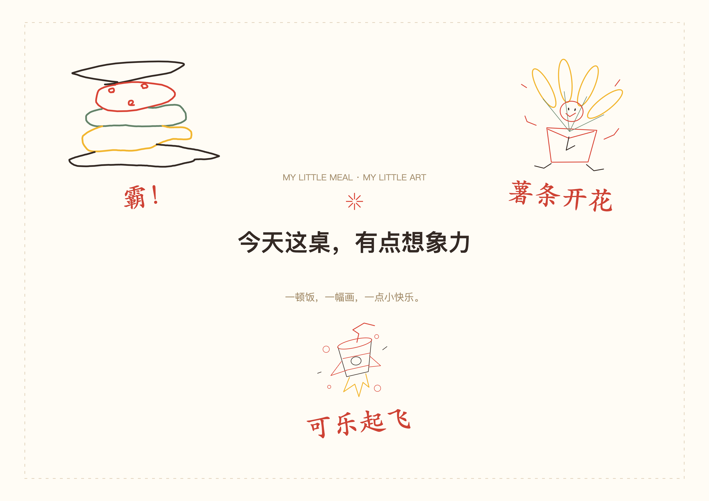

# 你画我点

项目仓库：[https://github.com/Rabbitgenius-rgb/you-draw-my-meal](https://github.com/Rabbitgenius-rgb/you-draw-my-meal) · [参赛进度](docs/SUBMISSION_STATUS.md)

把今天的餐品画下来，再把积攒的小画拼成自己的餐纸。单人自由画，双人轮流猜；真实门店和菜单来自麦当劳 MCP，画作默认私密。



本项目是本机运行的 **Web 应用**，面向喜欢随手涂鸦、记录一餐、和朋友猜画的用户。由 Codex 辅助开发，非麦当劳官方产品。公开画廊当前只在本机浏览器模拟，尚无账户、云端画作或跨设备同步。

## 安装与启动

需要 Node.js 22 或更新版本、npm，以及首次安装依赖所需的网络。

```sh
npm ci
npm start
```

打开 [本机预览](http://127.0.0.1:4173/web/index.html)。通过 HTTP 访问，不要直接双击 HTML 文件。若端口占用，可运行 `PORT=4176 npm start`；端口不同意味着浏览器数据独立。

### 无 Token 体验画册和餐纸

进入「我的画册」→「体验三幅示例」→阅读摘要并确认。示例包括作者原笔迹“霸！”及新原创“薯条开花”“可乐起飞”，均默认私密；重复导入不新增。展开「我的餐纸」，打开「今天这桌，有点想象力」，即可切换版式、放大、保存及下载。

示例使用独立门店/餐品 ID，不进入真实菜单，也不是 MCP 查询失败时的回退。该路径展示画册与餐纸能力；真实选餐绘画仍需 MCP 连接成功。示例素材的使用范围见[素材说明](docs/MATERIAL_SOURCES.md)。

### 连接真实 MCP

从[麦当劳开放平台](https://open.mcd.cn/mcp)申请自己的 Token。首页点击「连接麦当劳」，粘贴后保存。也可复制 `.env.example` 为 `.env.local`，设置 `MCD_MCP_TOKEN=` 并在页面重新检查连接。

Token 只交给本机后端，页面保存时写入权限为 `600` 的 `.env.local`；不会读回、写入小程序或示例。请勿将真实值提交 Git。配置示例 [mcp-config.example.json](mcp-config.example.json)仅供外部 MCP 客户端参考，本项目不会自动读取该文件。

## 使用流程

1. **选店、选餐。**搜索城市和地标，选一家返回的门店，获取到店自取菜单。「换一道」支持搜索和分类，底部开始按钮保持可见。
2. **单人或双人画画。**两种模式都在画布对照餐品绘画，支持颜色、笔刷、橡皮、撤销/重做和收起参考。双人使用同一设备轮流画猜，交接隐藏答案，不是远程联机。
3. **保存和检索。**作品默认私密，保留门店、餐品、时间和原笔迹；画册支持搜索、按门店/餐品/公开状态筛选及沿结果前后浏览。可导入 PNG/JPG，单张原文件不超过 8 MB，保存最长边 1000px 的 JPEG 副本。
4. **逐张授权。**明确允许后，作品进入对应门店和餐品的本机画廊；可随时撤回。每道餐品最多 3 张预览和总数，作品墙支持最新/随机浏览及放大。
5. **制作餐纸。**选择 3～6 张画作，切换留白、规则满铺、错落拼贴；编辑主标题、署名、作品标题、顺序和大小。预览、保存及导出使用同一渲染规则。
6. **备份与恢复。**「备份整册」导出作品、素材、版本、餐纸及草稿的 JSON。导入先预检，同内容去重、冲突另存，新增作品默认私密，已有许可保持不变。草稿自动保存，刷新后可继续；双人恢复仍隐藏答案。

数据按记录保存在 IndexedDB，通过事务和修订号避免同浏览器多标签互相覆盖。它不是云端备份；清理网站数据或换浏览器前，请先下载整册备份。备份含你的历史，勿公开上传，详见[数据与隐私](docs/PRIVACY.md)。

餐纸保存明确的画作版本引用：替换或删除原画不会改变旧方案，需在编辑器主动更新为最新版。旧模板保留原布局。点击下载时冻结内容和文件名，离开编辑页仍可完成。

餐纸下载为 **4961×3508px PNG（A3 横版比例）**；画作单独下载：笔迹为 PNG，导入图片副本为 JPG。当前无打印 PDF、实体餐垫下单或门店定制。

## 检查与重建示例

```sh
npm run check
npm test
npm run examples:build
npm run public:scan
```

`public:scan` 是离线文件启发式检查，不读本机凭证，也不上传源码。它排除依赖、Git 目录和安装时生成的精确空设备配置；若设备配置带有实际内容则报错。最终打包仍须排除所有本机配置、依赖和备份。

本次候选包的实际检查结果见[公开版审查记录](docs/PUBLIC_RELEASE_REVIEW.md)。自动测试使用本机协议夹具和模拟 IndexedDB，不代表当天真实 MCP 可用、微信真机验收或公开发布。录屏尚未制作，已有[演示脚本](docs/DEMO_SCRIPT.md)和[录屏清单](docs/RECORDING_CHECKLIST.md)。

公开候选64/64测试通过；候选版排除暂停的局域网联调脚本及3项对应测试。三幅示例、重复导入去重、三模板、放大和实际4961×3508 PNG下载均在独立浏览器来源验证。

## 参赛与许可证

[官方规则](https://github.com/M-China/mcd-developer-innovation-challenge/blob/main/activityGuidelines.md)允许基于麦当劳 MCP 的应用程序等软件项目，要求真实使用 MCP、发布个人公开 GitHub 仓库，并通过官方 Issue 报名。2026 年 10 月 15 日核对的截止时间为北京时间 **2026 年 10 月 25 日 23:59**。本项目采用 Codex，不申报 WorkBuddy 专项奖励、不含 `workbuddy.md`。

必需文件已包含：[官方声明](CONTEST_DECLARATION.md)、[MCP 接入说明](MCP_INTEGRATION.md)、[脱敏配置](mcp-config.example.json)及可运行源码。后续操作见[提交清单](docs/SUBMISSION_CHECKLIST.md)和[报名正文草稿](docs/ISSUE_DRAFT.txt)。报名状态以[参赛进度](docs/SUBMISSION_STATUS.md)和官方Issue回复为准。

项目原创源码采用 [MIT](LICENSE)。依赖保留各自许可证，见[第三方声明](THIRD_PARTY_NOTICES.md)。**“霸！”原笔迹不纳入源码 MIT 授权**；仅随本项目提供演示用途，其他使用需作者许可。官方声明、麦当劳商标及实时返回的餐品摄影不归本项目授权，完整范围见 [NOTICE](NOTICE.md)。

`miniprogram/` 保留小程序源码，当前为游客 AppID，未做微信编译或真机验收；本次交付与参赛沿用 Web。公开包不附带临时局域网联调服务或任何设备配置。
